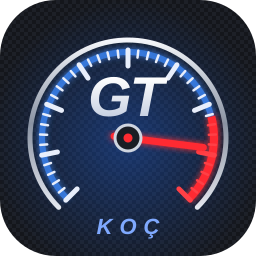

<p align="center">
  
</p>

<h1 align="center">GT7 Türkçe Koç</h1>

<p align="center">
  <b>Gran Turismo 7 için Türkçe, sesli sürüş koçu.</b><br>
  <i>A Turkish-language voice driving coach for Gran Turismo 7 (Windows + PS5).</i>
</p>

<p align="center">
  <a href="https://github.com/jsph52/gt7-koc/releases/download/son-surum/GT7-Koc.exe"><b>⬇ GT7-Koc.exe'yi indir</b></a>
  &nbsp;·&nbsp;
  <a href="https://github.com/jsph52/gt7-koc/releases/tag/son-surum">Sürüm sayfası</a>
</p>

---

GT7 Türkçe Koç, PS5'in ev ağına gönderdiği telemetriyi okur, her virajı o virajdaki en iyi geçişinle
karşılaştırır ve zaman kaybının sebebini sesli, kısa tavsiyelerle söyler. Ücretsizdir; hesap, abonelik ve
kurulum gerektirmez.

## Hızlı başlangıç

1. **İndir:** [GT7-Koc.exe](https://github.com/jsph52/gt7-koc/releases/download/son-surum/GT7-Koc.exe)
   dosyasını indir ve çalıştır. Kurulum gerekmez; kayıtların **Belgeler › GT7 Koc** klasöründe tutulur.
2. **Bağlan:** PS5 ile bilgisayar aynı ev ağında olsun ve GT7 açık olsun. Koç PS5'i kendisi bulur.
3. **Sür:** Piste çık. Pist, araba ve antrenman otomatik algılanır.

**Gereksinimler:** Windows 10 / 11, PS5 ve Gran Turismo 7, aynı ev ağı, ses için internet bağlantısı.

## Özellikler

### Sürüş koçluğu

- **Viraj tavsiyesi:** Tekrar eden hatalarda, viraja yaklaşırken tek cümle ("Frene biraz daha geç bas.").
- **Çıkış geri bildirimi:** Tavsiye uygulandıysa onay, sürüyorsa kısa hatırlatma.
- **Fren uyarısı:** Fren noktasına üç sesli geri sayım; hıza göre kayar, tepki payını sürdükçe öğrenir.
- **Hassasiyet:** Koçun konuşma eşiği, beş seviye (%10 ile %1 arası kayıp).
- **Odak virajı:** Koç yalnızca seçilen virajı çalıştırır.

### Analiz

- **Tur sonu değerlendirmesi:** Tur süresi ve en çok zaman kaybedilen virajda ne yapılmalı.
- **Viraj analizi:** Fren, çizgi, gaz, direksiyon ve vites; her viraj dört aşamada ölçülür.
- **İdeal tur:** Bütün virajların en iyi geçişlerinden oluşan süre.
- **İnceleme:** Oyun duraklatılınca seansın özeti ve sıradaki odak noktası.
- **Karşılaştırma:** İki turun hız, gaz, fren ve zaman farkı grafiği.
- **Seans raporu:** Her antrenman için tek sayfalık rapor.

### Time Trial ve hedefler

- **Haftalık etkinlikler:** Rekor, altın süre ve kalan gün.
- **Hedef süre:** Dünya rekoru, altın, gümüş, bronz ya da elle yazılan süre.
- **Rekor turu:** Replay'den kaydedilen bir tura göre koçluk ve fren noktaları.

### Yarış mühendisi

- **Yakıt ve pit:** Yakıtın bitişe yetip yetmediği, pit turu, doldurma oranı ve yakıt ayarı önerisi.
- **Araç durumu:** Motor sıcaklıkları, yağ basıncı ve lastik sıcaklıkları.
- **Yarış akışı:** Sıra değişimi, son tur ve bitiş anonsları.

### Araç ayarı

- **Ayar önerileri:** Kilitlenme, patinaj, önden / arkadan kayma, vites oranı ve yerden yükseklik.
- **Çekiş türü:** Sürüşten otomatik algılanır; dört çekerde güç dağılımı önerisi verilir.

### Ekran ve ses

- **Koç ekranı:** Canlı fark, sıradaki viraj, harita, lastikler, yakıt, turlar ve koç mesajları.
- **Basit görünüm:** Sürerken bir bakışta okunacak sade düzen.
- **Geçmiş antrenmanlar:** Pist, araba, tur ve en iyi tur; rapor görüntüleme ve silme.
- **Telefon ve tablet:** Aynı ağdan tarayıcıyla erişim.
- **Ses:** İki Türkçe ses, hız, düzey, telsiz efekti ve ses cihazı seçimi.
- **Discord:** Koçun sesini PS5 kulaklığına iletir (isteğe bağlı).

### Otomatik algılama

- **PS5:** Adres değişse bile ev ağında bulunur.
- **Pist:** 122 pist düzeni; konumdan algılanır.
- **Antrenman:** Piste çıkınca başlar.
- **Veri yönlendirme:** Telemetriyi SimHub gibi başka bir programa da iletir.

## Ayarlar

| Bölüm | İçerik |
|---|---|
| **Koç** | Hassasiyet, fren uyarısı, tepki payı ve kalibrasyon. |
| **Ses** | Sesli koç, konuşma türleri, ses, hız, düzey, telsiz efekti, ses çıkışı. |
| **Discord** | Bağlantı, bot anahtarı, sesli kanal ve kurulum rehberi. |
| **Bağlantı** | PS5 adresi, veri yönlendirme, telefon adresi, kayıt klasörü. |

## Sorun giderme

| Sorun | Çözüm |
|---|---|
| **PS5 bulunamıyor** | GT7'yi aç; **Ayarlar › Bağlantı › PS5'i ağda bul** ya da adresi elle yaz. |
| **Veri gelmiyor** | Telemetri kullanan başka programı kapat ya da **Veri yönlendirme**'yi kullan; güvenlik duvarında izin ver. |
| **Ses yok** | Üst çubukta ses açık mı, **Ayarlar › Ses** ve internet bağlantısını kontrol et. |
| **Diğer** | **Belgeler › GT7 Koc** klasöründeki `koc_gunluk.txt` dosyasına bak. |

## Bilinmesi gerekenler

- **Telemetri sınırı:** GT7 lastik aşınmasını, hava durumunu, yakıt ayarını ve araç ayarlarını göndermez.
- **Referans:** Koç seni kendi en iyi geçişlerinle ya da seçtiğin rekor turuyla karşılaştırır.
- **Tek program:** Aynı bilgisayarda telemetri dinleyen başka bir programla aynı anda çalışmaz.

## Gizlilik

- **Kayıtlar:** Yalnızca bilgisayarında, **Belgeler › GT7 Koc** klasöründe tutulur.
- **Ses:** Microsoft'un çevrim içi ses servisine yalnızca okunacak cümle gönderilir.
- **Time Trial:** Herkese açık bir rapordan okunur; Sony sunucularına bağlanılmaz.

## Geliştiriciler için

Kod `koc/` klasöründedir; giriş noktası `koc/gt7_arayuz.py`.

```bash
python koc/gt7_arayuz.py
```

İsteğe bağlı paketler: `edge-tts`, `pywebview`, `discord.py`, `PyNaCl`, `davey`, `miniaudio`. Windows EXE'si
`main` dalındaki her güncellemede GitHub Actions ile üretilir (`.github/workflows/exe.yml`).

## Lisans

Telif hakkı © 2026 jsph52. GT7 Türkçe Koç, [GNU Genel Kamu Lisansı sürüm 3](LICENSE) (GPL-3.0) ile dağıtılır.

- **Serbest:** Kodu kullanabilir, inceleyebilir, değiştirebilir ve paylaşabilirsin.
- **Şart:** Değiştirilmiş bir sürümü dağıtırsan kaynak kodunu da aynı lisansla açman gerekir.
- **Garanti:** Program olduğu gibi sunulur, hiçbir garanti verilmez.

Aşağıdaki parçalar kendi lisanslarıyla gelir.

## Kaynaklar ve lisanslar

- **Telemetri:** [gt7-datalogger](https://github.com/jbhoorasingh/gt7-datalogger) (MIT, `koc/alinan/`).
- **Pist çizgileri:** [gt7-datalogger-track-data](https://github.com/jbhoorasingh/gt7-datalogger-track-data)
  (CC0 / MIT), [gt-telemetry](https://github.com/zetetos/gt-telemetry) (MIT),
  [GT7Tracks](https://github.com/vthinsel/GT7Tracks) (MIT).
- **Araba ve pist bilgisi:** [gt7info](https://github.com/ddm999/gt7info) (MIT-0).
- **Time Trial:** [gt7-timetrials](https://gt7-timetrials.github.io/) raporu.
- **Ses:** [edge-tts](https://github.com/rany2/edge-tts).
- **Yazı tipi:** Barlow Condensed (SIL Open Font License).

GT7 Türkçe Koç bağımsız bir hayran projesidir; Sony Interactive Entertainment ya da Polyphony Digital ile
bağlantılı değildir. "Gran Turismo", "GT7" ve "PlayStation" ilgili sahiplerinin markalarıdır.
